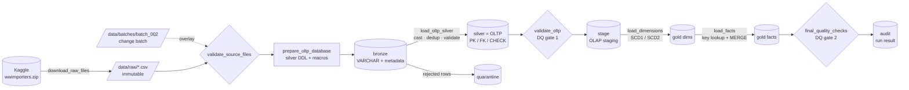
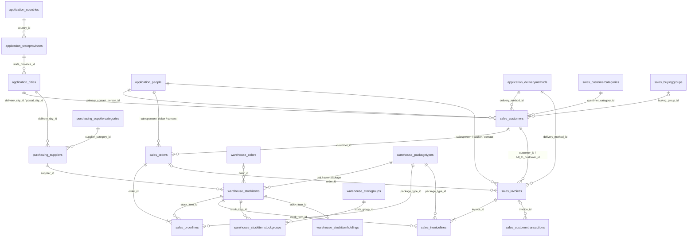
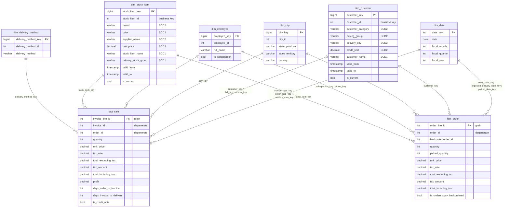

# Wide World Importers – End-to-End Data Pipeline (DuckDB)

An end-to-end, re-runnable data pipeline that takes the **Wide World Importers (WWI)** CSV export,
lands it in a staging layer, builds a constraint-enforced **OLTP** database, and transforms it into an
analytics-ready **star schema** with **SCD Type 2** dimensions — using **DuckDB for every SQL
operation and every data load**, orchestrated by **plain Python functions**.

```text
Download CSV ─► raw files ─► BRONZE (staging) ─► SILVER (OLTP) ─► STAGE (OLAP staging) ─► GOLD (dims + facts)
                 data/raw     CSV → VARCHAR       typed, PK/FK      flattened, joined        SCD1/SCD2 dims,
                 (immutable)  + run metadata      + quarantine      per grain                fact_order, fact_sale
```

The case-study brief is in [`case_study.md`](case_study.md). Evidence from real runs is in
[`docs/evidence/`](docs/evidence/).

---

## Contents

1. [Solution overview](#1-solution-overview)
2. [Technology stack and prerequisites](#2-technology-stack-and-prerequisites)
3. [Setup](#3-setup)
4. [Getting the raw files](#4-getting-the-raw-files)
5. [Running the pipeline (single entry point)](#5-running-the-pipeline-single-entry-point)
6. [Project layout](#6-project-layout)
7. [Architecture and orchestration](#7-architecture-and-orchestration)
8. [OLTP model (silver)](#8-oltp-model-silver)
9. [Dimensional model (gold)](#9-dimensional-model-gold)
10. [Source-to-target mapping](#10-source-to-target-mapping)
11. [Slowly changing dimensions](#11-slowly-changing-dimensions)
12. [Idempotency and duplicate prevention](#12-idempotency-and-duplicate-prevention)
13. [Data quality and failure behaviour](#13-data-quality-and-failure-behaviour)
14. [Logging and audit](#14-logging-and-audit)
15. [Business questions](#15-business-questions)
16. [Evidence of execution](#16-evidence-of-execution)
17. [Assumptions and limitations](#17-assumptions-and-limitations)
18. [Solution questions](#18-solution-questions)
19. [Sources and credits](#19-sources-and-credits)

---

## 1. Solution overview

| Layer | DuckDB schema | What it holds | Refresh strategy |
|---|---|---|---|
| Raw | files in `data/raw/` | The CSV files exactly as downloaded – never modified | Downloaded once |
| Bronze (staging) | `bronze` | One table per CSV, every column `VARCHAR`, plus `_source_file`, `_run_id`, `_ingested_at` | Replaced every run |
| Silver (OLTP) | `silver` | Normalized WWI OLTP model with data types, `PRIMARY KEY`, `UNIQUE`, `NOT NULL`, `CHECK`, `FOREIGN KEY`; history versions in `*_archive` tables | Rebuilt every run from bronze |
| Quarantine | `quarantine` | Rows rejected by the silver load, with reason and original raw record | Append-only |
| OLAP staging | `stage` | Flattened rows per dimension member and per fact grain, built **only from silver** | Rebuilt every run |
| Gold (OLAP) | `gold` | `dim_date`, `dim_city`, `dim_customer` (SCD2), `dim_employee`, `dim_stock_item` (SCD2), `dim_delivery_method`, `fact_order`, `fact_sale` | Incremental: SCD merge + fact `MERGE` |
| Audit | `audit` | Run log, step log, ingestion log, load statistics, SCD/fact statistics, DQ results | Append-only |

Everything lives in a single DuckDB file (`data/warehouse/wwi.duckdb`); schemas separate the layers
(the "OLTP database" is the `silver` schema, the "warehouse" is `stage` + `gold`).

## 2. Technology stack and prerequisites

| Concern | Choice |
|---|---|
| Database / SQL engine | **DuckDB 1.4.4** (embedded, single file, no server) |
| CSV ingestion | DuckDB `read_csv(...)` |
| Transformations | DuckDB SQL (`sql/` files + SQL generated from the catalog for the generic loaders) |
| SCD / fact loading | DuckDB `UPDATE … FROM`, `INSERT`, `MERGE INTO` |
| Orchestration | Python functions with explicit dependencies (`src/wwi_pipeline/pipeline.py`) |
| Download | Python standard library (`urllib`, `zipfile`) – Kaggle REST API |

Prerequisites: **Python ≥ 3.10** and ~3 GB free disk (≈0.9 GB raw CSV + ≈1.5 GB database).
The full pipeline runs in about one minute on a 4-core machine with 16 GB RAM.
The only Python dependency is `duckdb`.

## 3. Setup

```bash
git clone https://github.com/imjbmkz/asb-de-cs.git
```

```bash
cd asb-de-cs
```

```bash
python3 -m venv .venv && source .venv/bin/activate
```

```bash
pip install -r requirements.txt
```

Optionally `pip install -e .` installs the package and a `wwi-pipeline` console command;
`run_pipeline.py` works without installing anything.

Credentials are never committed: copy `.env.example` to `.env` (git-ignored) or export the
variables in your shell.

## 4. Getting the raw files

Dataset: [Wide World Importers CSV dataset on Kaggle](https://www.kaggle.com/datasets/pauloviniciusornelas/wwimporters).

**Automatic (recommended).** The pipeline's first task downloads the dataset when required files are
missing:

1. Create a Kaggle API token (Kaggle → Settings → *Create New Token*).
2. Put `KAGGLE_USERNAME` / `KAGGLE_KEY` into `.env`, or place `kaggle.json` in `~/.kaggle/`.
3. Run the pipeline (or only `python run_pipeline.py download`).

The zip is downloaded to `data/downloads/` and its CSV files are extracted into `data/raw/`.
If Kaggle cannot be reached, the downloader falls back to an unofficial public mirror of the same
export (`WWI_MIRROR_URL`; set it to an empty value to disable the fallback).

**Manual.** Download the zip from Kaggle and unzip the CSV files into `data/raw/`
(sub-folders and file-name case do not matter – `Sales_Customers.csv` and `sales_customers.csv`
are both recognised). Use `--raw-dir` to point to another folder.

Required files: `application_{countries,stateprovinces,cities,people,deliverymethods}`,
`purchasing_{suppliercategories,suppliers}`,
`warehouse_{colors,packagetypes,stockgroups,stockitems,stockitemstockgroups}`,
`sales_{customercategories,buyinggroups,customers,orders,orderlines,invoices,invoicelines}`.
Optional (loaded into the OLTP layer when present): `application_paymentmethods`,
`application_transactiontypes`, `warehouse_stockitemholdings`, `sales_customertransactions`.

## 5. Running the pipeline (single entry point)

```bash
python run_pipeline.py run
```

That one command downloads the data if needed, validates the files, builds the OLTP database,
ingests the CSVs, validates the OLTP load, builds the OLAP staging tables, loads the dimensions
(with SCD processing) and facts, runs the final data-quality checks and records the result.
It exits non-zero if any task fails. (`make pipeline` does the same.)

Other commands:

| Command | Purpose |
|---|---|
| `python run_pipeline.py demo --fresh` | Reproduces **all evidence**: initial load, identical re-run, generates the change batch, loads it, re-runs it, runs the business queries – writes to `docs/evidence/` |
| `python run_pipeline.py make-scd-batch` | Creates the second input batch in `data/batches/batch_002/` |
| `python run_pipeline.py run --batch-dir data/batches/batch_002 --batch-label batch_002` | Runs the pipeline with the change batch overlaid on the raw files |
| `python run_pipeline.py report` | Runs the business queries → `docs/evidence/business_queries.md` |
| `python run_pipeline.py download` | Download only |

Useful options: `--raw-dir`, `--db`, `--threads`, `--no-download`, `--force-download`.
Environment overrides: `WWI_RAW_DIR`, `WWI_DB_PATH`, `WWI_LOG_DIR`, `WWI_MEMORY_LIMIT`.

Explore the result with the DuckDB CLI or Python:

```bash
python -c "import duckdb; print(duckdb.connect('data/warehouse/wwi.duckdb', read_only=True).sql('SELECT * FROM audit.pipeline_runs'))"
```

## 6. Project layout

```text
run_pipeline.py                  single entry point (no install needed)
Makefile                         convenience targets
src/wwi_pipeline/
  cli.py                         commands: run | demo | download | make-scd-batch | report
  pipeline.py                    ORCHESTRATION: task functions, dependency graph, runner
  download.py                    step 0 – Kaggle download (+ mirror fallback)
  sources.py                     registry of source CSV files (FK load order)
  bronze.py                      CSV → bronze (DuckDB read_csv, metadata, file hash)
  silver.py                      bronze → OLTP: typing, de-dup, constraint validation, quarantine
  gold.py                        OLAP staging, dimension specs, fact MERGE
  scd.py                         generic SCD Type 1 / Type 2 merge
  quality.py                     data-quality checks (OLTP gate + final gate)
  scd_batch.py                   builds the second (change) input batch
  report.py                      run summaries + business-query report (Markdown)
  db.py, config.py, logging_utils.py
  sql/
    audit_ddl.sql                audit + quarantine tables
    silver/00_macros.sql         parsing macros (dates, booleans, integers)
    silver/01_oltp_ddl.sql       OLTP table definitions (types, PK, FK, UNIQUE, CHECK)
    gold/00_olap_ddl.sql         dimensions, facts, unknown members
    gold/01_stage.sql            OLAP staging queries (silver → stage)
    gold/02_dim_date.sql         calendar + fiscal calendar generation
    gold/10_fact_order_source.sql  surrogate-key resolution for fact_order
    gold/11_fact_sale_source.sql   surrogate-key resolution for fact_sale
    analysis/q*.sql              business questions
docs/evidence/                   run summaries, logs, business-query results
```

## 7. Architecture and orchestration

### Pipeline architecture



### Orchestration

`pipeline.py` defines every step as a Python function and declares its upstream dependency. The runner
executes them in topological order, writes each outcome to `audit.step_log` and the run log, and
marks downstream tasks `SKIPPED` when an upstream task fails. Recording the pipeline result
always runs.

| # (case study §6.4) | Task | Depends on |
|---|---|---|
| 0 | `download_raw_files` | – |
| 1 | `validate_source_files` | download |
| 2 | `prepare_oltp_database` | validate |
| 3 | `ingest_csv_to_bronze` → `load_oltp_silver` | prepare OLTP |
| 4 | `validate_oltp` | silver load |
| 5 | `prepare_olap` (gold DDL + `stage` tables) | OLTP validation |
| 6 | `load_dimensions` (dim_date + SCD) | prepare OLAP |
| 7 | `load_facts` | dimensions |
| 8 | `final_quality_checks` | facts |
| 9 | `record_pipeline_result` | always |

## 8. OLTP model (silver)

The silver schema reproduces the WWI OLTP tables required for sales (plus a few optional ones)
with source column names converted to snake_case (`CustomerID → customer_id`). Definitions are in
[`sql/silver/01_oltp_ddl.sql`](src/wwi_pipeline/sql/silver/01_oltp_ddl.sql).



**How the silver loader works** (`silver.py`) – the DDL is the single source of truth; the loader
reads each table's columns and constraints from DuckDB's catalog (`information_schema`,
`duckdb_constraints()`) and generates the SQL:

1. **Typing.** Every bronze `VARCHAR` is cast to the declared type with macros from
   `00_macros.sql`: empty string → `NULL`; `'1.0'` → `1` (the export writes nullable integers as
   floats); `'True'/'False'` → boolean; day-first dates `dd-mm-yyyy hh:mm[:ss]` (and ISO) → timestamp.
   Unparsable values (e.g. `31-02-2016`) become `NULL` and are counted as *invalid casts*.
   `VARCHAR` values are kept exactly as delivered.
2. **Exact duplicates** (identical in every source column) are dropped and counted.
3. **Constraint validation** – `NOT NULL`, `CHECK` and `FOREIGN KEY` (anti-join against the
   already-loaded parent table). Failing rows go to `quarantine.rejected_records` together with
   the reason and the original raw record (JSON).
4. **Duplicate business keys** – WWI tables are *system-versioned temporal tables* and the export
   contains several versions per key (e.g. 3,784 customer rows for 1,484 customers). The current
   version (latest `valid_to`, then latest `valid_from`) is loaded; the other versions go to
   `silver.<table>_archive` (same idea as WWI's `*_Archive` tables). For non-temporal tables the
   latest `last_edited_when` wins and the rest is quarantined.
5. **Insert** – DuckDB enforces the constraints again as a safety net.

Foreign keys from `LastEditedBy` to `People` and self references (`BillToCustomerID`,
`BackorderOrderID`) are not declared; they are validated as data-quality checks instead.

## 9. Dimensional model (gold)



### Fact-table grain

| Fact | Grain | Source | Measures |
|---|---|---|---|
| `fact_order` | **One row per customer order line** (`OrderLineID`) | `Sales.Orders` + `Sales.OrderLines` | quantity, picked quantity, unit price, tax rate, total excl. tax (`qty × price`), tax amount, total incl. tax, backorder flag / backorder order |
| `fact_sale` | **One row per customer invoice line** (`InvoiceLineID`) | `Sales.Invoices` + `Sales.InvoiceLines` (+ `Sales.Orders` for order date) | quantity, unit price, tax rate, tax amount, total excl. tax (`ExtendedPrice − TaxAmount`), total incl. tax (`ExtendedPrice`), profit (`LineProfit`), days order→invoice, days invoice→delivery |

### Design decisions

* **Surrogate keys** are integers assigned deterministically (`max(key) + row_number()` ordered by
  business key), so a rebuild from scratch reproduces the same keys; business keys are kept (`customer_id`, …) for
  traceability. Every dimension has an **Unknown member with key 0** (`dim_date` uses `-1`); fact
  lookups that do not match resolve to it (`coalesce(key, 0)`) so facts are never lost, and a
  warning-level DQ check counts them. Optional roles (picked date, delivery date) stay `NULL`.
* **dim_date** is generated (2013-01-01 … 2017-12-31, extended automatically to any transaction
  date). WWI's financial year starts on **1 November**: fiscal month 1 = November, and the fiscal
  year is named after the calendar year in which it ends (2015-11-01 … 2016-10-31 = **FY2016**).
* **dim_city** denormalizes City → StateProvince → Country (sales territory, region, lat/long parsed
  from the WKT point).
* **dim_customer** denormalizes category, buying group, bill-to customer, primary contact, delivery
  method and delivery city.
* **dim_stock_item** denormalizes colour, selling/buying package, supplier and stock groups. Items can
  belong to several stock groups; `primary_stock_group` (the most specific group, i.e. the one with
  the fewest items) is used as the *product category* and `stock_groups` lists all groups.
* **dim_employee** contains `People` rows with `IsEmployee = 1` (role-played as salesperson and picker).
* **`fact_order.city_key` / `fact_sale.city_key`** come from the delivery city of the customer
  *version valid on the transaction date*, so geography follows customer history.
* Header-level attributes (order/invoice IDs, customer PO number) are degenerate dimensions on the line facts.

## 10. Source-to-target mapping

| Kaggle CSV file | WWI OLTP table | Silver (OLTP) table | Gold target |
|---|---|---|---|
| `application_countries.csv` | Application.Countries | `silver.application_countries` | `dim_city` (country, continent, region, subregion) |
| `application_stateprovinces.csv` | Application.StateProvinces | `silver.application_stateprovinces` | `dim_city` (state, sales territory); `dim_customer.delivery_state_province` |
| `application_cities.csv` | Application.Cities | `silver.application_cities` | `dim_city`; `dim_customer.delivery_city` |
| `application_people.csv` | Application.People | `silver.application_people` (+ `_archive`) | `dim_employee`; `dim_customer.primary_contact` |
| `application_deliverymethods.csv` | Application.DeliveryMethods | `silver.application_deliverymethods` | `dim_delivery_method`; `dim_customer.delivery_method` |
| `sales_customercategories.csv` | Sales.CustomerCategories | `silver.sales_customercategories` | `dim_customer.customer_category` |
| `sales_buyinggroups.csv` | Sales.BuyingGroups | `silver.sales_buyinggroups` | `dim_customer.buying_group` |
| `sales_customers.csv` | Sales.Customers | `silver.sales_customers` (+ `_archive`) | `dim_customer` |
| `warehouse_stockitems.csv` | Warehouse.StockItems | `silver.warehouse_stockitems` (+ `_archive`) | `dim_stock_item` |
| `warehouse_colors.csv` | Warehouse.Colors | `silver.warehouse_colors` | `dim_stock_item.color` |
| `warehouse_packagetypes.csv` | Warehouse.PackageTypes | `silver.warehouse_packagetypes` | `dim_stock_item` packages; `fact_*.package` |
| `warehouse_stockgroups.csv` + `warehouse_stockitemstockgroups.csv` | Warehouse.StockGroups / StockItemStockGroups | `silver.warehouse_stockgroups`, `silver.warehouse_stockitemstockgroups` | `dim_stock_item.primary_stock_group`, `stock_groups` |
| `purchasing_suppliers.csv` + `purchasing_suppliercategories.csv` | Purchasing.Suppliers / SupplierCategories | `silver.purchasing_suppliers`, `silver.purchasing_suppliercategories` | `dim_stock_item.supplier_name` |
| `sales_orders.csv` + `sales_orderlines.csv` | Sales.Orders / OrderLines | `silver.sales_orders`, `silver.sales_orderlines` | `fact_order`; `fact_sale.order_date_key` |
| `sales_invoices.csv` + `sales_invoicelines.csv` | Sales.Invoices / InvoiceLines | `silver.sales_invoices`, `silver.sales_invoicelines` | `fact_sale` |
| `application_paymentmethods.csv`, `application_transactiontypes.csv`, `sales_customertransactions.csv`, `warehouse_stockitemholdings.csv` | (optional) | loaded into silver | not used by the sales mart (extension point) |

Column-level derivations of the facts are in
[`gold/01_stage.sql`](src/wwi_pipeline/sql/gold/01_stage.sql) and the key resolution in
[`gold/10_fact_order_source.sql`](src/wwi_pipeline/sql/gold/10_fact_order_source.sql) /
[`gold/11_fact_sale_source.sql`](src/wwi_pipeline/sql/gold/11_fact_sale_source.sql).

## 11. Slowly changing dimensions

Implemented generically in [`scd.py`](src/wwi_pipeline/scd.py); the attribute lists per dimension
are in [`gold.py`](src/wwi_pipeline/gold.py).

| Dimension | Type 2 (history kept) | Type 1 (overwritten) |
|---|---|---|
| `dim_customer` | customer category, buying group, bill-to customer, delivery city/state/postal code, credit limit, payment days, standard discount | customer name, bill-to name, primary contact, delivery method, phone, website, account-opened date, credit-hold and statement flags |
| `dim_stock_item` | brand, size, colour, selling/buying package, supplier, chiller flag, tax rate, unit price, recommended retail price | name, stock groups/category, barcode, lead time, quantity per outer, typical weight |
| `dim_city`, `dim_employee`, `dim_delivery_method` | – | all attributes (SCD1) |

**Why:** type-2 attributes are the ones analysts segment revenue by (category, buying group,
territory via delivery city, brand, price, supplier) – restating history when they change would
silently move past revenue between segments. Type-1 attributes are identifiers, contact details or
corrections where only the latest value matters. Cities, employees and delivery methods are
reference data whose changes are corrections, so SCD1 keeps the model simple.

**Columns:** surrogate key (`customer_key`), business key (`customer_id`), `valid_from`,
`valid_to` (half-open interval, open end `9999-12-31`), `is_current`, plus `_t2_hash` / `_t1_hash`
(MD5 of the attribute sets, used for change detection) and lineage run IDs.

**Algorithm (per run, inside one transaction):**

1. Compare each staged row with the current version of its business key via the hashes.
2. *New key* → insert with `valid_from = 1900-01-01` (first known version is back-dated so all
   historical facts resolve).
3. *Type-1 change* → overwrite those attributes on **all** versions of the key.
4. *Type-2 change* → close the current row (`valid_to = effective timestamp`, `is_current = false`)
   and insert a new current row with a **new surrogate key**. The effective timestamp is the source's
   own change time (`ValidFrom` of the temporal OLTP row) when it is later than the current version's
   start, otherwise the run timestamp.
5. *No change* → nothing happens (re-runs create no versions).

**Fact resolution:** facts join SCD2 dimensions on business key **and**
`transaction_date ∈ [valid_from, valid_to)`, so every order/sale points to the version valid on
its order/invoice date. When a later change arrives, the fact `MERGE` re-resolves keys and updates
only the affected lines.

**Demonstration (two loads).** The Kaggle export is a single snapshot, so
`make-scd-batch` creates a second input batch **as source files** (no target table is edited):
it rewrites `sales_customers.csv` and `warehouse_stockitems.csv` the way a temporal table would
after an update – the changed row becomes the current version with `ValidFrom = 2016-07-15`, the
previous row is kept as history. Business keys are unchanged. Changes
([manifest](docs/evidence/batch_002_manifest.json)):

| Business key | Change | Expected |
|---|---|---|
| Customer 74 | category Novelty Shop → Supermarket | SCD2 |
| Customer 62 | buying group Tailspin Toys → Wingtip Toys | SCD2 |
| Customer 14 | credit limit none → 5,000 and payment days 7 → 30 | SCD2 (one new version) |
| Customer 2 | phone number | SCD1 (no new version) |
| Stock item 4 | brand none → Northwind | SCD2 |
| Stock item 10 | unit price 32.00 → 35.00 | SCD2 |
| Stock item 97 | lead time 14 → 21 days | SCD1 |

Result after the second load (from [`run_batch_002.md`](docs/evidence/run_batch_002.md) and
[`business_queries.md`](docs/evidence/business_queries.md) Q9/Q10):

* `dim_customer`: 3 new versions + 1 type-1 update; `dim_stock_item`: 2 new versions + 1 type-1 update.
* Old versions are kept and closed with `valid_to = 2016-07-15`; new current versions have new surrogate keys.
* `fact_sale` re-pointed 6,657 lines and `fact_order` 8,455 lines dated on/after 2016-07-15 to the new
  versions; e.g. customer 74's invoices from 2016-06-01 – 07-14 stay on key 74 (*Novelty Shop*),
  those from 07-15 – 07-31 resolve to the new key 1487 (*Supermarket*).
* Re-running batch 2 produces **0** new versions and **0** fact changes.

## 12. Idempotency and duplicate prevention

* **Bronze, silver and stage** are full refreshes of the current input – running twice yields
  identical tables.
* **Dimensions**: hash-based change detection – identical input ⇒ no inserts/updates
  (`audit.scd_log.unchanged` = all rows on a re-run).
* **Facts**: `MERGE INTO … ON <grain key>` with a row hash: new lines inserted, lines whose
  attributes or resolved keys changed updated, unchanged lines untouched, lines that disappeared from
  the OLTP source deleted. A re-run reports `inserted = updated = deleted = 0`.
* **`dim_date`** and unknown members are insert-if-missing.
* Primary keys on every fact grain and surrogate key, plus DQ checks for unique grain, one current
  version per key, no overlaps/gaps and *no redundant versions* (consecutive versions with identical
  type-2 hashes would indicate an unnecessary version).
* Every gold step runs in a transaction; a failure rolls back that step.

Evidence: compare [`run_batch_001.md`](docs/evidence/run_batch_001.md) with
[`run_batch_001_rerun.md`](docs/evidence/run_batch_001_rerun.md).

## 13. Data quality and failure behaviour

Checks are defined in [`quality.py`](src/wwi_pipeline/quality.py) and stored in `audit.dq_results`.

**Behaviour chosen:** *quarantine invalid records, fail on critical checks.*

* Row-level problems (missing required values, unparsable values in required columns, `CHECK`
  violations, orphan foreign keys, duplicate keys) do **not** stop the pipeline: the rows are written
  to `quarantine.rejected_records` with the reason and raw record, and the load continues.
* **Critical** checks stop the run (task `FAILED`, downstream `SKIPPED`, run recorded as `FAILED`,
  non-zero exit code). This includes a tolerance check: if more than 5 % of a table is quarantined the
  run fails, so a broken file cannot silently empty the warehouse.
* **Warning** checks are recorded and logged only.

| Gate | Checks |
|---|---|
| OLTP (after silver) | PKs not null; business keys unique; bill-to customer exists; backorder references; quantities > 0; prices/tax ≥ 0; extended price = qty × price + tax; dates valid and in range; expected delivery ≥ order date; invoice date ≥ order date; delivery ≥ invoice; bronze = silver + archive + quarantine + duplicates (reconciliation); quarantine share ≤ 5 %; core tables not empty |
| Final (after facts) | Per dimension: unique surrogate key, business key not null, exactly one current version, `valid_from < valid_to`; SCD2: no overlapping ranges, no gaps, current = open-ended, no redundant versions; fiscal calendar rule; unique fact grain; fact count = staged count; sales amount and ordered quantity reconcile with OLTP; fact keys not null and existing in dimensions; Unknown-member usage; **point-in-time check** (every fact's customer/stock-item version is valid on its transaction date); measure validity |

Findings on the supplied data (every run): 43 order lines without an order, 41 invoices whose order
does not exist (plus their 41 invoice lines and 41 customer transactions) are quarantined
(166 rows of ~5.8 M). 12 supplier versions have an empty `DeliveryAddressLine1`, so that column is
nullable in silver (it is `NOT NULL` in WWI) rather than rejecting suppliers and – through the
foreign keys – most products and sales.

## 14. Logging and audit

* Console + file log per run: `logs/pipeline_<run_id>.log`.
* `audit.pipeline_runs` – run id, batch label, source/batch dirs, start/end, status, error.
* `audit.step_log` – every orchestrated task with status and duration.
* `audit.ingestion_log` – source file, size, **SHA-256**, rows loaded, run id, timestamp.
* `audit.silver_load_log` – per table: bronze rows, exact duplicates, archived versions, quarantined, loaded, invalid casts.
* `audit.scd_log`, `audit.fact_load_log` – per dimension/fact load statistics.
* `audit.dq_results`, `audit.run_metrics`; `quarantine.rejected_records`.
* Every bronze row carries `_source_file`, `_run_id`, `_ingested_at`; every fact row `_run_id`, `_loaded_at`;
  every dimension row `_inserted_run_id`, `_updated_run_id`.

## 15. Business questions

SQL in [`src/wwi_pipeline/sql/analysis/`](src/wwi_pipeline/sql/analysis/), results in
[`docs/evidence/business_queries.md`](docs/evidence/business_queries.md).

| # | Question | Query |
|---|---|---|
| 1 | Sales, quantity, profit by month and fiscal year | `q01_sales_by_month_fiscal_year.sql` |
| 2 | Top products and product categories | `q02a_top_products.sql`, `q02b_product_categories.sql` |
| 3 | Top customers and customer categories | `q03a_top_customers.sql`, `q03b_customer_categories.sql` |
| 4 | Sales/profit by city, state, sales territory | `q04a_sales_by_territory.sql`, `q04b_sales_by_city.sql` |
| 5 | Salespeople with the highest-value orders and sales | `q05_salespeople.sql` |
| 6 | Share of ordered quantity later invoiced | `q06_invoiced_proportion.sql` |
| 7 | Average days from order to invoice | `q07_days_to_invoice.sql` |
| 8 | Orders with backordered items and their impact | `q08_backorders.sql`, `q08b_backorders_by_customer_category.sql` |
| 9 | How tracked customer/product attributes changed | `q09_attribute_history.sql` |
| 10 | Correct historical attributes before/after an SCD change | `q10_point_in_time_attributes.sql`, `q10b_point_in_time_products.sql` |

## 16. Evidence of execution

Produced by `python run_pipeline.py demo --fresh` (four runs against one warehouse):

| File | Shows |
|---|---|
| [`run_batch_001.md`](docs/evidence/run_batch_001.md) / [`.log`](docs/evidence/run_batch_001.log) | Initial load: CSV → bronze ingestion, OLTP load, quarantine, dimension/fact loads, DQ results, row counts of every table |
| [`run_batch_001_rerun.md`](docs/evidence/run_batch_001_rerun.md) | Identical input re-processed: 0 new dimension versions, 0 fact inserts/updates/deletes |
| [`run_batch_002.md`](docs/evidence/run_batch_002.md) / [`.log`](docs/evidence/run_batch_002.log) | Second load with the change batch: SCD2 versions and SCD1 updates, facts re-pointed |
| [`run_batch_002_rerun.md`](docs/evidence/run_batch_002_rerun.md) | Change batch re-processed: no further changes |
| [`batch_002_manifest.json`](docs/evidence/batch_002_manifest.json) | The attribute changes contained in batch 2 |
| [`business_queries.md`](docs/evidence/business_queries.md) | SQL and results of all business questions, incl. SCD history (Q9/Q10) |

Headline row counts: bronze 5.8 M rows from 23 files; silver `sales_orderlines` 2,219,399,
`sales_invoicelines` 1,280,094, `sales_customers` 1,484 (+2,300 archived versions);
gold `fact_order` 2,219,399, `fact_sale` 1,280,094, `dim_customer` 1,488 rows after batch 2
(1,484 customers + 3 history versions + Unknown).

## 17. Assumptions and limitations

* **Dataset version.** The Kaggle export used here is a larger variant of WWI than Microsoft's
  sample: ~1.07 M orders between 2016-06-01 and 2016-08-01, invoices up to 2016-07-31 and 1,484
  customers. Its date format is day-first (`dd-mm-yyyy`) and nullable integers are written as floats.
  Because invoices stop on 2016-07-31 while orders continue, the "invoiced share" (Q6) is low for July
  and zero for August – a property of the extract, not of the pipeline.
* **Where the evidence data came from.** Kaggle was not reachable from the environment in which the
  evidence was produced, so the files were taken from the public mirror the downloader falls back to
  (same file names and CSV format). If the Kaggle archive differs (e.g. file-name case or a sub-folder),
  the pipeline still resolves the files; row counts in `docs/evidence/` may differ if the content does.
* **Source history.** The export mixes current and historical temporal-table versions whose ranges
  overlap (and a set of versions dated 2021). Rather than reconstruct history from inconsistent
  ranges, the OLTP layer keeps the current version per key and archives the rest, and **warehouse
  history starts with the first pipeline load** (first versions back-dated to 1900-01-01).
* **Unit price changes affect the dimension only**: invoice lines carry their own historical
  `UnitPrice`, so the stock-item price change in batch 2 shows up in `dim_stock_item`, not in already
  invoiced amounts.
* Deleted business keys are not end-dated in the dimensions (no soft delete) – the source has no
  delete feed. Fact lines missing from the OLTP snapshot are deleted from the facts (full-snapshot
  semantics).
* `primary_stock_group` is a single "category" chosen by rule (most specific group); items belong to
  several stock groups (all listed in `stock_groups`).
* Silver is a full refresh each run – appropriate for this data size (≈1 minute end-to-end), not for
  streaming volumes (see §18 Q5).
* The second batch is synthetic, generated from the snapshot, as permitted by the brief.
* One DuckDB file hosts both the OLTP and the OLAP schemas; DuckDB allows one writer at a time.

## 18. Solution questions

**1. Why these tools?**
*DuckDB* gives a full analytical SQL engine (window functions, `MERGE`, constraints,
fast parallel CSV reader) in a single file with zero infrastructure – anyone can reproduce the
pipeline with `pip install duckdb`. It loads the 900 MB export in ~15 s and the whole pipeline runs in
about a minute. *Ingestion* uses DuckDB's `read_csv` (all columns as text first, so nothing is lost
before validation). *Transformations* are SQL files run by DuckDB; repetitive per-table logic (casting,
constraint checks, SCD merges) is generated from DuckDB's own catalog so that the DDL stays the single
source of truth. *Orchestration* uses plain Python functions with explicit dependencies: for a single,
local, batch workflow this provides ordering, failure propagation, logging and one entry point without
running a scheduler service; the task functions map 1:1 onto Airflow/Dagster tasks if scheduling is
needed later.

**2. From OLTP to dimensional model; grain.**
Reference/lookup tables were folded into the dimensions they describe (snowflake → star):
City+StateProvince+Country → `dim_city`; Customers+Categories+BuyingGroups+People+DeliveryMethods+Cities →
`dim_customer`; StockItems+Colors+PackageTypes+Suppliers+StockGroups → `dim_stock_item`; People
(employees) → `dim_employee`. Header/line pairs were combined into line-level facts with header
attributes as degenerate dimensions and date roles: `fact_order` = **one row per order line**,
`fact_sale` = **one row per invoice line**. Measures such as totals, profit and lead times are derived
in the staging SQL.

**3. SCD types.** See [§11](#11-slowly-changing-dimensions): SCD2 for analytically significant
customer attributes (category, buying group, bill-to, delivery location, credit terms) and product
attributes (brand, size, colour, packaging, supplier, pricing, tax); SCD1 for names, contact details,
descriptive extras and for the city, employee and delivery-method dimensions.

**4. Duplicates and consistent re-runs.** See [§12](#12-idempotency-and-duplicate-prevention):
full-refresh of bronze/silver/stage, exact-duplicate and duplicate-key handling in silver, hash-based
SCD merge, `MERGE` on the fact grain with row hashes, insert-if-missing for static data, transactions
per step, and DQ checks that fail the run if duplicates or redundant versions appear. Evidence: the
re-runs change nothing.

**5. Millions of records per day, hourly updates.**
* **Incremental extraction**: CDC from the OLTP database (SQL Server CDC / temporal tables, or
  Debezium) or `LastEditedWhen` watermarks per table stored in an audit table, instead of full
  snapshots; land micro-batches as partitioned Parquet in object storage (S3/ADLS/GCS) rather than CSV.
* **Incremental processing**: process only changed keys – silver `MERGE` instead of rebuild; SCD merge
  over the changed business keys; facts appended/merged per date partition; late-arriving dimensions
  handled with inferred members that are later completed.
* **Storage/engine**: move from one embedded file to a lakehouse table format (Delta/Iceberg) or a
  cloud warehouse (Snowflake, BigQuery, Databricks, MotherDuck) that supports concurrent readers and
  writers, partitioning by date and clustering on keys.
* **Orchestration**: a scheduler with retries, back-fills, SLAs and alerting (Airflow, Dagster,
  Prefect) running the same task functions hourly; idempotency per batch id so retries are safe.
* **Quality & observability**: DQ checks per micro-batch with a data-contract layer (Great
  Expectations/Soda/dbt tests), quarantine tables kept, metrics and alerting on volumes, freshness and
  failure rates.
* **Modelling**: consider dbt for SQL modelling/tests/lineage, and aggregate tables or materialized
  views for the most common dashboards.

## 19. Sources and credits

* Dataset: *Wide World Importers* CSV export published on Kaggle (`pauloviniciusornelas/wwimporters`) –
  <https://www.kaggle.com/datasets/pauloviniciusornelas/wwimporters>.
* Sample database and schema documentation © Microsoft:
  [What is Wide World Importers](https://learn.microsoft.com/en-us/sql/samples/wide-world-importers-what-is?view=sql-server-ver15),
  [WideWorldImporters OLTP catalog](https://learn.microsoft.com/en-us/sql/samples/wide-world-importers-oltp-database-catalog?view=sql-server-ver15),
  [WideWorldImportersDW OLAP catalog](https://learn.microsoft.com/en-us/sql/samples/wide-world-importers-dw-database-catalog?view=sql-server-ver15).
* DuckDB – <https://duckdb.org>.
